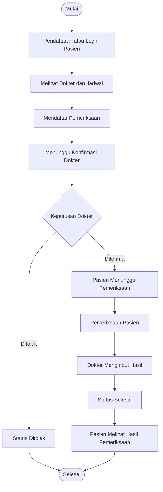

# 🏥 Sistem Pendaftaran dan Pelayanan Pasien

<p align="center">
  
  
  
  
</p>

<p align="center">
  <b>Solusi digital sederhana untuk menghubungkan proses pendaftaran pasien dan pelayanan dokter.</b>
</p>

<p align="center">
  <i>Patient Registration • Doctor Services • Local Data Management</i>
</p>

---

## 🩺 Tentang Proyek

**Sistem Pendaftaran dan Pelayanan Pasien** merupakan aplikasi desktop berbasis Java yang dirancang untuk membantu proses pendaftaran pemeriksaan dan pelayanan pasien di rumah sakit.

Sistem ini terdiri dari dua aplikasi yang saling terhubung:

| 🧑‍⚕️ Aplikasi Pasien | 🩺 Aplikasi Dokter |
|:---:|:---:|
| Registrasi dan pengelolaan akun | Pengelolaan jadwal praktik |
| Pendaftaran pemeriksaan | Konfirmasi pendaftaran |
| Pemantauan status pendaftaran | Pengelolaan pemeriksaan |
| Melihat hasil pemeriksaan | Pencatatan hasil pemeriksaan |

Kedua aplikasi menggunakan penyimpanan data lokal yang sama sehingga informasi dapat dikelola secara terintegrasi.

## ✨ Fitur Utama

### 👤 01 — Aplikasi Pasien

Aplikasi yang digunakan pasien untuk mendaftar dan mendapatkan pelayanan rumah sakit.

| No. | Fitur | Keterangan |
|:---:|---|---|
| 01 | Registrasi akun | Membuat akun pasien baru |
| 02 | Login dan logout | Masuk dan keluar dari aplikasi |
| 03 | Profil pasien | Melihat dan mengubah data pribadi |
| 04 | Daftar dokter | Melihat dokter yang tersedia |
| 05 | Jadwal praktik | Melihat hari dan jam praktik dokter |
| 06 | Pendaftaran pemeriksaan | Memilih dokter dan jadwal pemeriksaan |
| 07 | Riwayat pendaftaran | Melihat seluruh pendaftaran yang pernah dibuat |
| 08 | Ubah atau batalkan pendaftaran | Selama status masih menunggu |
| 09 | Status pendaftaran | Memantau perkembangan pendaftaran |
| 10 | Hasil pemeriksaan | Melihat hasil pelayanan yang telah diselesaikan dokter |

### 🩺 02 — Aplikasi Dokter

Aplikasi yang digunakan dokter untuk mengelola jadwal dan memberikan pelayanan kepada pasien.

| No. | Fitur | Keterangan |
|:---:|---|---|
| 01 | Login dan logout | Masuk dan keluar dari aplikasi |
| 02 | Profil dokter | Melihat dan mengubah informasi profil |
| 03 | Kelola jadwal praktik | Menambah, mengubah, dan menghapus jadwal |
| 04 | Daftar pasien terdaftar | Melihat pasien pada jadwal praktik |
| 05 | Detail pendaftaran | Melihat informasi pendaftaran pasien |
| 06 | Konfirmasi pendaftaran | Menerima atau menolak pendaftaran |
| 07 | Kelola status pemeriksaan | Mengubah status pemeriksaan |
| 08 | Input hasil pemeriksaan | Mencatat keluhan, diagnosis, dan hasil pemeriksaan |
| 09 | Riwayat pelayanan | Melihat riwayat pemeriksaan pasien |

> [!IMPORTANT]
> Akun dokter disediakan sebelumnya oleh pengelola rumah sakit. Dokter hanya dapat menggunakan akun yang telah diberikan dan tidak melakukan registrasi sendiri.

## 🔄 Alur Sistem

Berikut gambaran sederhana interaksi antara pasien dan dokter.



## 🎨 Konsep Desain Antarmuka

GUI dirancang menggunakan konsep **Modern Medical Dashboard**, dengan tampilan minimalis, profesional, dan mudah digunakan.

**Karakteristik desain:**

- Sidebar permanen di sebelah kiri.
- Area konten utama di sebelah kanan.
- Navigasi halaman menggunakan `CardLayout`.
- Dashboard dengan kartu statistik dan tabel informasi.
- Formulir yang sederhana dan mudah dibaca.
- Komponen `JTable` dengan tampilan rapi.
- Halaman login dan registrasi terpisah dari dashboard.
- Konsistensi warna, tipografi, ukuran tombol, dan jarak antarkomponen.

### 🎨 Color Palette

<p align="center">
  
  
  
</p>

| Nama | Hex | Karakter |
|---|---|---|
| Merino | `#F5EEDD` | Krem lembut |
| Rock Blue | `#84B3CE` | Biru muda |
| Venice Blue | `#16587B` | Biru tua |

## 🛠️ Teknologi

<p align="center">
  
</p>

| Teknologi | Penggunaan |
|---|---|
| Java | Bahasa pemrograman utama |
| Java Swing | Pengembangan GUI desktop |
| NetBeans IDE | Lingkungan pengembangan |
| GUI Builder | Pembuatan GUI dengan drag-and-drop |
| Metal Look and Feel | Look and Feel bawaan Swing |
| CSV | Penyimpanan data lokal |

## 🧩 Arsitektur dan Struktur Proyek

Proyek menggunakan pendekatan modular untuk memisahkan antarmuka, model data, logika bisnis, autentikasi, dan pengelolaan penyimpanan.

```text
SistemRumahSakit/
│
├── Source Packages/
│   └── rumahsakit/
│       │
│       ├── pasien/
│       │   ├── MainPasien.java
│       │   ├── FormLoginPasien
│       │   ├── FormMenuPasien
│       │   ├── FormProfilPasien
│       │   ├── FormDaftarDokter
│       │   ├── FormJadwalDokter
│       │   ├── FormPendaftaran
│       │   ├── FormRiwayatPendaftaran
│       │   └── FormHasilPemeriksaan
│       │
│       ├── dokter/
│       │   ├── MainDokter.java
│       │   ├── FormLoginDokter
│       │   ├── FormMenuDokter
│       │   ├── FormProfilDokter
│       │   ├── FormKelolaJadwal
│       │   ├── FormDaftarPasien
│       │   ├── FormDetailPendaftaran
│       │   ├── FormPemeriksaan
│       │   └── FormRiwayatPelayanan
│       │
│       ├── model/
│       │   ├── Pengguna.java
│       │   ├── Pasien.java
│       │   ├── Dokter.java
│       │   ├── JadwalPraktik.java
│       │   ├── Pendaftaran.java
│       │   ├── Pelayanan.java
│       │   └── StatusPendaftaran.java
│       │
│       ├── service/
│       │   ├── AuthService.java
│       │   ├── PasienService.java
│       │   ├── DokterService.java
│       │   ├── JadwalService.java
│       │   ├── PendaftaranService.java
│       │   └── PelayananService.java
│       │
│       ├── repository/
│       │   ├── PenggunaRepository.java
│       │   ├── PasienRepository.java
│       │   ├── DokterRepository.java
│       │   ├── JadwalRepository.java
│       │   ├── PendaftaranRepository.java
│       │   └── PelayananRepository.java
│       │
│       ├── storage/
│       │   ├── PenyimpananFile.java
│       │   └── CsvUtil.java
│       │
│       ├── auth/
│       │   ├── PasswordUtil.java
│       │   └── SessionManager.java
│       │
│       └── utils/
│           ├── Validasi.java
│           ├── FormatTanggal.java
│           └── IDGenerator.java
│
├── data/
│   ├── pengguna.csv
│   ├── pasien.csv
│   ├── dokter.csv
│   ├── jadwal.csv
│   ├── pendaftaran.csv
│   └── pelayanan.csv
│
├── Test Packages/
├── Libraries/
└── Project Files/
```

### 📁 Fungsi Setiap Package

| Package/Folder | Tanggung Jawab |
|---|---|
| `pasien` | GUI dan alur aplikasi pasien |
| `dokter` | GUI dan alur aplikasi dokter |
| `model` | Representasi objek dan atribut data |
| `service` | Logika proses dan aturan bisnis |
| `repository` | Operasi membaca dan mengelola data |
| `storage` | Pengelolaan file CSV |
| `auth` | Autentikasi, hash password, dan sesi pengguna |
| `utils` | Fungsi bantuan umum |
| `data` | Penyimpanan data aplikasi |

> **Catatan:** Setiap JFrame Form dari NetBeans GUI Builder memiliki pasangan file `.java` dan `.form`. Nama form dalam struktur ditulis tanpa ekstensi.

## 💾 Penyimpanan Data

Aplikasi menggunakan file CSV sebagai media penyimpanan lokal tanpa database eksternal.

| File | Data yang Disimpan |
|---|---|
| `pengguna.csv` | Informasi akun dan autentikasi |
| `pasien.csv` | Data profil pasien |
| `dokter.csv` | Data profil dokter |
| `jadwal.csv` | Jadwal praktik dokter |
| `pendaftaran.csv` | Data pendaftaran pemeriksaan |
| `pelayanan.csv` | Data hasil pelayanan dan pemeriksaan |

Kedua aplikasi mengakses kumpulan data yang sama melalui package `repository` dan `storage`.

## 🚀 Cara Menjalankan Proyek

1. Pastikan JDK dan NetBeans IDE telah terpasang.
2. Clone repository atau unduh proyek ini.
3. Buka NetBeans IDE.
4. Pilih **File → Open Project**.
5. Pilih folder `SistemRumahSakit`.
6. Tunggu hingga proyek selesai dimuat.
7. Jalankan kelas utama sesuai aplikasi yang ingin digunakan:
   - `MainPasien.java` — Aplikasi Pasien.
   - `MainDokter.java` — Aplikasi Dokter.

## 🌱 Pengembangan Selanjutnya

Beberapa fitur tambahan yang dapat dikembangkan setelah fitur utama selesai:

- [ ] Nomor antrean pasien.
- [ ] Cetak bukti pendaftaran.
- [ ] Cetak hasil pemeriksaan.
- [ ] Pencarian pasien berdasarkan ID atau nama.
- [ ] Filter data berdasarkan tanggal.
- [ ] Notifikasi perubahan status pendaftaran.

## 👥 Kontribusi

Proyek ini dikembangkan secara kolaboratif. Setiap anggota berkontribusi dalam pengembangan bagian aplikasi sesuai pembagian tugas tim.

## 📌 Status Proyek

**Tahap pengembangan:** Perencanaan dan persiapan struktur proyek.

Fitur dan struktur yang tercantum merupakan rancangan pengembangan dan dapat disesuaikan selama proses implementasi.

---

<p align="center">
  <b>🏥 Sistem Pendaftaran dan Pelayanan Pasien</b>
  <br/>
  <i>Better Service Through Simple Technology.</i>
</p>
